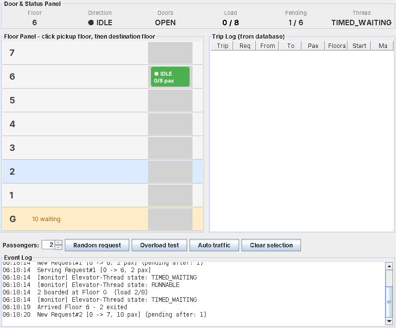

# Elevator Controller Simulation

**CSE2003 | Object Oriented Programming using Java | B.Tech CSE Semester 3 | Mini Project**
**Group 16** - A simulation of a multi-floor elevator where requests are handled by threads.



## Team

| Role | Name | UID |
|------|------|-----|
| Leader | Aaditya | 2510001278 |
| Member 1 | Rohanpreet | 2510001359 |
| Member 2 | Dev | 2510001297 |
| Member 3 | Tanish | 2510001366 |

## Modules

| # | Module | Where |
|---|--------|-------|
| 1 | Floor and car setup | `Floor`, `ElevatorCar`, `Simulation` |
| 2 | Request handling | `Request`, `RequestQueue`, `ElevatorController.submitRequest`, `RequestGenerator` |
| 3 | Elevator movement simulation | `ElevatorController.processRequests`, `Movable` / `ElevatorCar.moveUp/moveDown` |
| 4 | Door and status panel | `ElevatorCar` door states, status strip + `FloorCell` in `ElevatorGUI`, `StatusMonitor` |
| 5 | Trip log | `TripLogDAO` (JDBC) + trip table in the GUI |

## Syllabus concepts applied

| Unit | Concept | Where it is used |
|------|---------|------------------|
| 1 | Classes, objects, arrays, constructors | `Floor`, `Request`, `ElevatorCar`; `Floor[]` array in `Simulation`; overloaded constructor `Floor(int)` / `Floor(int, String)` |
| 2 | Interface `Movable` | `Movable.java`, implemented by `ElevatorCar` |
| 2 | Abstract class `Controller` | `Controller.java`, extended by `ElevatorController` |
| 2 | Package `elevator.sim` | every class lives in `src/main/java/elevator/sim` |
| 3 | Thread life cycle with `sleep` and priorities | `Simulation.start()` (priorities 8 / 5 / 1), `Thread.sleep` in `ElevatorCar` and `RequestGenerator`, `StatusMonitor` prints NEW / RUNNABLE / WAITING / TIMED_WAITING |
| 3 | Synchronized request queue | `RequestQueue` (`synchronized`, `wait()` / `notifyAll()`) |
| 3 | `OverloadException` | thrown by `RequestQueue.add` (queue full) and `ElevatorCar.board` (too many passengers) |
| 4 | JDBC to store trip log | `TripLogDAO` - tables `requests` and `trips` |
| 5 | Swing `GridLayout` floor panel | `ElevatorGUI` (floor panel + status strip) |
| 5 | `BorderLayout` | main frame: status NORTH, floors CENTER, trip log EAST, controls and log SOUTH |
| 5 | Mouse events | `FloorCell` (`mouseClicked`, `mouseEntered`, `mouseExited`, right-click cancel) |

## Database tables

```
requests(id, from_floor, to_floor, passengers, requested_at, status)
trips(id, request_id -> requests.id, from_floor, to_floor, passengers,
      floors_travelled, started_at, duration_ms)
```
Request status goes PENDING -> IN_PROGRESS -> COMPLETED, or REJECTED_QUEUE_FULL / REJECTED_OVERLOAD.

## How it works

```
 GUI clicks / RequestGenerator (threads)
            |  submitRequest()
            v
     RequestQueue  (synchronized, max 6)  --OverloadException--> rejected
            |  take() nearest pickup floor first
            v
  ElevatorController (Elevator-Thread, priority 8)
     go to pickup -> open doors -> board (OverloadException?) -> close
     -> go to destination -> open -> unload -> close
            |
            v
       TripLogDAO  ->  elevator_trips.db
```

## Run it

You need JDK 17 or newer.

**Option A - Maven (easiest)**
```bash
mvn compile exec:java
```

**Option B - plain javac**
1. Download these two jars from Maven Central into `lib/`:
   - `org.xerial:sqlite-jdbc` (e.g. 3.46.1.0)
   - `org.slf4j:slf4j-api` (e.g. 1.7.36)
2. Run `./run.sh` (Linux/macOS) or `run.bat` (Windows).

If the jars are missing the simulation still runs, but trips are kept in memory only and the log says so.

**Headless demo (no window):** `./run.sh --console 30`

## Using the GUI

- Click a floor to choose the **pickup** floor, then click another floor for the **destination**. Right-click cancels.
- **Passengers** spinner sets how many people are in the request.
- **Random request** adds one random request. **Auto traffic** starts a background thread that adds them continuously.
- **Overload test** sends more passengers than the car holds (capacity 8) - the car opens, sounds the overload message in the log and cancels that request.
- Sending more than 6 pending requests triggers the queue-full `OverloadException`.

## Push to GitHub

```bash
cd elevator-controller-simulation
git init
git add .
git commit -m "Elevator Controller Simulation - Group 16"
git branch -M main
git remote add origin https://github.com/<your-username>/<repo-name>.git
git push -u origin main
```

## Project layout

```
elevator-controller-simulation/
  pom.xml
  run.sh / run.bat
  lib/                      (put driver jars here for Option B)
  docs/screenshot.png
  src/main/java/elevator/sim/
    Movable.java  Controller.java  ElevatorController.java  ElevatorCar.java
    Floor.java  Request.java  RequestQueue.java  OverloadException.java  Direction.java
    RequestGenerator.java  StatusMonitor.java  Simulation.java  SimulationListener.java
    TripLogDAO.java  ElevatorGUI.java  FloorCell.java  Main.java
```
